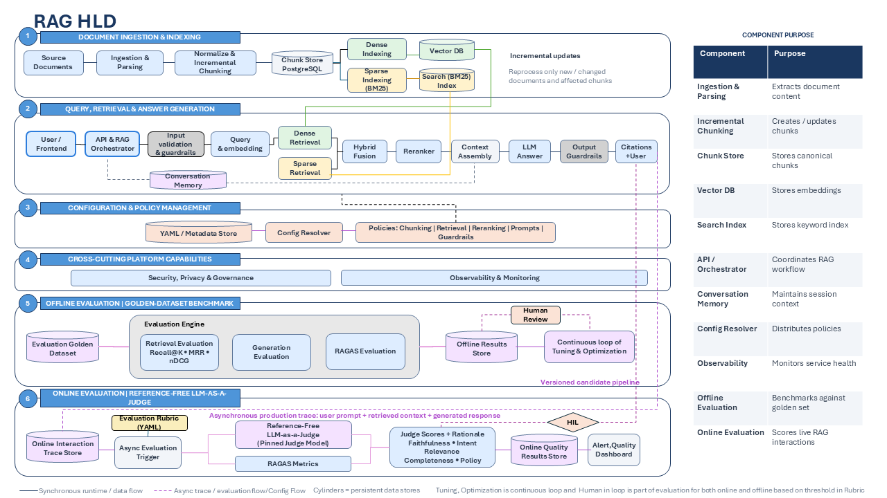

# RAG System Design

## 1. Introduction

This HLD outlines an enterprise-grade RAG platform designed to support multiple business use cases through reusable, independently scalable services and domain-specific configurations.

As a product leader, the focus is on delivering a secure, reliable and extensible platform that enables downstream teams to launch use cases faster without rebuilding core RAG capabilities. Shared services such as document ingestion, retrieval, vector indexing, guardrails and evaluation are designed for reuse, while domain-specific requirements are managed through configurable policies, metadata and prompts.
The ultimate objective is on building a platform that balances **business value, customer experience, scalability, cost efficiency and responsible AI**.

Key design principles include:

- **Scalability and reusability:** Independently scalable services, workload isolation, rate limiting and model routing to support multiple use cases, varying traffic patterns and cost-efficient resource utilization.
- **Customer experience and answer quality:** Grounded, relevant and explainable responses with source citations, appropriate latency and graceful handling of low-confidence or unsupported queries.
- **Cost and performance:** Balance model quality, response latency and infrastructure costs through caching, model routing and efficient resource utilization.
- **Security and responsible AI:** Enforce enterprise access controls, data privacy and compliance through input/output guardrails covering prompt injection, jailbreaking, PII exposure and unsafe or unsupported responses.
- **Pragmatic architecture choices:** Use agentic orchestration only where dynamic reasoning or multi-step decisions add value; keep deterministic, predictable capabilities as services to improve reliability, latency and cost.
- **Continuous quality improvement:** Combine offline golden-dataset evaluation with online monitoring to identify quality degradation, trigger human review where needed, and prioritize retrieval, prompt, model and configuration improvements.

The platform also incorporates production capabilities such as load balancing, rate limiting, model routing, observability and cost monitoring. The objective is not simply to deploy a RAG pipeline, but to establish a governed platform that balances business agility, customer trust, operational resilience and long-term scalability.

## Architecture Diagram

## 2. End-to-end architecture flow

| Section | Main flow | Outcome |
|---|---|---|
| 1. Offline ingestion and indexing | Source Documents → Ingestion & Parsing → Normalize & Incremental Chunking → Chunk Store (PostgreSQL) → Dense Indexing / Sparse Indexing → Vector DB / Search Index | Canonical chunks and dense/sparse indexes are available for retrieval. |
| 2. Online query and generation | Web UI → FastAPI → Input Guardrails → Query Embedding → Dense + Sparse Retrieval → Hybrid Fusion → Reranker → Context Assembly → LLM Answer → Output Guardrails → Citations + User | Grounded answer returned with source citations. |
| 3. Configuration and policy | YAML / Metadata Store → Config Resolver → Policies for chunking, retrieval, reranking, prompts and guardrails | Runtime components use versioned, centrally managed configuration. |
| 4. Cross-cutting capabilities | Security, Privacy & Governance; Observability & Monitoring | Identity, access, audit, privacy and operational visibility apply across the platform. |
| 5. Offline evaluation | Golden Dataset → Evaluation Run → Retrieval Evaluation + Generation Evaluation + RAGAS Evaluation → Offline Results Store → Regression Report / Release Readiness | Candidate changes are benchmarked against known ground truth before release. |
| 6. Online evaluation | Online Trace Store → Async Evaluation Trigger → Reference-Free Judge and RAGAS metrics → Judge Scores + Rationale → Online Quality Results Store → Quality Dashboard / Alerts | Sampled or risk-selected production interactions are evaluated without requiring per-interaction expected answers. |

## 3. Component catalogue — purpose and technology stack

Technology selections below are implementation examples, not mandatory dependencies.

### 3.1 Ingestion and retrieval components

| Component shown in diagram | Purpose | Technology stack examples |
|---|---|---|
| Source Documents | Retain original legal documents, source identity and access metadata. | Enterprise document repositories; GCS / S3 |
| Chunk Store & Metadata | Store canonical chunks, document and chunk IDs, version metadata and source references. | PostgreSQL |
| Dense Index | Store chunk embeddings and support semantic retrieval. | Approved embedding model; pgvector / Chroma / Milvus |
| Sparse Search Index | Support lexical search and BM25-based retrieval. | Elasticsearch / OpenSearch |
| Web UI | Provide the interface for document questions and cited answers. | React / Next.js |
| API & RAG Orchestrator | Expose authenticated query APIs and coordinate retrieval, ranking, context assembly and answer generation. | FastAPI; LangGraph |
| Guardrails & Citations | Validate inputs and outputs against security and policy rules; check answer grounding and return source citations. | NeMo Guardrails or equivalent; deterministic policy checks; citation resolver |
| Query Embedding | Convert user queries into vectors compatible with document embeddings. | Same embedding model family/version used for document indexing |
| Dense Retrieval | Retrieve semantically similar chunks. | pgvector / Chroma / Milvus |
| Sparse Retrieval | Retrieve keyword matches using lexical search. | Elasticsearch / OpenSearch BM25 |
| Hybrid Fusion | Combine dense and sparse ranked results into a unified candidate set. | Reciprocal Rank Fusion (RRF) |
| Reranker | Reorder candidate chunks based on query–chunk relevance. | Cross-encoder reranker, e.g. BGE |
| Context Assembly & LLM Answer | Assemble bounded evidence context and generate an answer grounded in retrieved documents. | Approved enterprise LLM endpoint; versioned prompts |
| Conversation Memory | Maintain permitted session context without replacing authoritative document evidence. | Redis |

### 3.2 Configuration and cross-cutting components

| Component shown in diagram | Purpose | Technology stack examples |
|---|---|---|
| Configuration & Metadata Store | Maintain domain metadata, policies, prompts, retrieval settings and evaluation rubrics. | Git-managed YAML; PostgreSQL |
| Security, Privacy & Governance | Enforce identity, authorization, document-level access, encryption, audit and retention. | Enterprise IdP (OIDC/OAuth2); KMS; audit logging |
| Observability & Monitoring | Capture traces, latency, errors, token and cost usage, and service health. | OpenTelemetry; Prometheus / Grafana; LangSmith or equivalent |

### 3.3 Evaluation and trace components

| Component shown in diagram | Purpose | Technology stack examples |
|---|---|---|
| Golden Dataset | Maintain curated questions, reference answers and ground-truth relevant document/chunk IDs. | Versioned dataset; PostgreSQL / object storage |
| Offline Evaluation | Run candidate RAG versions against the golden dataset and assess retrieval and answer quality. | RAGAS; Recall@K; Precision@K; MRR; nDCG |
| Offline Results & Regression Report | Persist benchmark results, compare against baselines and assess release thresholds. | PostgreSQL / object storage; CI/CD reporting |
| Interaction Trace Capture & Store | Capture complete RAG interactions, including query, retrieved context, answer, citations and pipeline versions, for subsequent evaluation. | OpenTelemetry; PostgreSQL; object storage |
| Async Evaluation Trigger | Select captured interactions for evaluation based on sampling, risk rules or defined triggers. | Queue / event bus |
| Online RAGAS & LLM-as-a-Judge | Evaluate live interactions without requiring golden reference answers; assess relevance, faithfulness and policy adherence. | RAGAS; pinned enterprise judge model; versioned evaluation rubric |
| Online Quality Results Store | Persist evaluation scores, rationales, evaluator and rubric versions, and trace references. | PostgreSQL; object storage |
| Quality Dashboard & Alerts | Monitor quality trends, low-score rates, evaluator disagreement and interactions requiring human review. | Grafana / BI dashboard; alerting integration |

## 4. Interaction Trace — definition and data captured

An **interaction trace** is the persisted record of one complete RAG execution. It is not an LLM or a scoring algorithm. It records the question, evidence retrieved, answer produced and execution metadata so the same production interaction can be evaluated asynchronously and audited later.

**Flow:** online RAG execution → trace capture → trace store → asynchronous evaluation trigger. Trace capture should be non-blocking: the customer response should not wait for RAGAS or the judge. Apply access controls, encryption, data minimization and retention policies to trace content.

## 5. Offline evaluation — golden-dataset benchmark

Offline evaluation is used to measure quality against curated ground truth and to run regression tests before a candidate configuration or model is promoted.

### 5.1 Offline evaluation metrics

| Evaluation area | What is compared | Metric / interpretation |
|---|---|---|
| Retrieval | Retrieved IDs/ranks vs ground-truth relevant IDs | Recall@K: fraction of relevant items retrieved in top K |
| Retrieval | Retrieved IDs/ranks vs ground-truth relevant IDs | Precision@K: fraction of top K retrieved items that are relevant |
| Retrieval | Rank of first relevant result | MRR: average reciprocal rank of first relevant result |
| Retrieval | Ranked list vs relevance grades | nDCG: ranking quality, rewarding relevant items near the top |
| Generation | Generated answer vs reference answer and supporting context | Reference-based correctness and quality checks |
| RAGAS | Question, generated answer, retrieved contexts and reference where required | Faithfulness, Answer Relevancy, Context Precision and Context Recall |

Use the offline benchmark after changes to chunking, embeddings, retrieval, reranking, prompts, guardrails or models. Version the dataset, evaluator and pipeline configuration to make results comparable.

## 6. Online evaluation — reference-free production quality

Online or live evaluation does not require a golden benchmark answer for each production interaction. It uses the captured interaction trace: original query, retrieved context and generated answer. It should run asynchronously on sampled or risk-selected interactions.

### 6.1 Online evaluation dimensions

| Dimension / method | Inputs | What it checks | Important limitation |
|---|---|---|---|
| Faithfulness — RAGAS | Generated answer + retrieved contexts | Whether answer claims are supported by retrieved evidence | Does not prove the retrieved document is the correct/current authoritative source |
| Faithfulness — direct judge | Generated answer + retrieved contexts + rubric | Claim support with classifications and explanation | LLM judgement is a quality signal; calibrate against human review |
| Answer Relevancy — RAGAS | Original query + generated answer | Semantic alignment between answer content and original question | Does not prove factual correctness or guarantee full intent fulfilment |
| Answer Relevance — direct judge | Original query + generated answer + rubric | Whether the answer actually fulfils the user's intent | Rubric and judge model must be versioned and calibrated |
| Context Precision / Relevance | Original query + ranked retrieved contexts | Whether retrieved chunks are relevant and ranked usefully | Evaluator relevance judgements may be imperfect |
| Completeness | Query + answer; optionally retrieved context | Whether important parts of the request are covered | Stronger assurance needs expected criteria or human review |
| Policy / Tone Adherence | Query + answer + policy rubric | Whether response follows policy and appropriate tone | Use deterministic rules where possible |

### 6.2 RAGAS Answer Relevancy — how it is calculated

RAGAS Answer Relevancy uses an LLM to generate questions that the generated answer would address. It then embeds those generated questions and the original user query, calculates semantic similarity (cosine similarity), and aggregates the similarities (commonly by averaging).

| Step | Operation | Example |
|---|---|---|
| 1 | Original user query | “What is the termination notice period under this agreement?” |
| 2 | Generated answer | “Either party may terminate the agreement with 30 days’ written notice.” |
| 3 | LLM-generated question from answer | “How much notice is required to terminate the agreement?” |
| 4 | Embedding | Embed original query and generated question using the configured embedding model |
| 5 | Similarity | Calculate cosine similarity between the embeddings |
| 6 | Aggregation | Average similarity across generated questions to produce the metric score |

A high score indicates semantic alignment. It is not a factual-correctness score. Exact implementation details depend on the RAGAS version and metric configuration.

### 6.3 Direct LLM-as-a-Judge answer relevance — how it differs

The direct judge does not need to reverse-engineer the answer into questions. It receives the original user query and generated answer, identifies the user's intent, and evaluates whether the answer fulfils that intent.

| User query | Generated answer | Direct judge interpretation |
|---|---|---|
| “What is the termination notice period?” | “Either party may terminate with 30 days’ written notice.” | Fully relevant: directly provides the period |
| Same query | “The agreement contains a termination clause.” | Partially relevant: related topic but omits the requested period |
| Same query | “The agreement includes confidentiality and indemnification clauses.” | Irrelevant: does not address termination notice |

### 6.4 Why use both RAGAS and a direct judge?

| Method | Distinct contribution |
|---|---|
| RAGAS Answer Relevancy | Embedding-based semantic alignment using questions generated from the answer |
| Direct LLM Judge relevance | Rubric-based assessment of whether the answer fulfils the user's intent |

They assess overlapping quality dimensions using different methods. Store their scores separately; do not treat them as independent proof or blindly average them. Use disagreement as a signal for review and calibrate both against human-reviewed examples.

### 6.5 Critical distinction

| Dimension | What it establishes |
|---|---|
| Faithfulness | Answer is supported by the context retrieved by the RAG system |
| Answer relevance | Answer addresses the user's query |
| Factual correctness | Answer is true according to an authoritative source |

If the retriever selects an outdated agreement stating 30 days while the current executed agreement states 60 days, faithfulness and relevance may both score highly while the answer is factually wrong. Therefore, validate authoritative document status, version and effective date, and escalate conflicts.

## 8. Production operating model

| Execution timing | Controls / activities |
|---|---|
| Synchronous — before response | User authorization; document-level access; authoritative document status/version/effective-date validation; citation checks; critical policy checks; abstention or escalation for missing/conflicting evidence |
| Asynchronous — after response | Persist interaction trace; sampling/risk-based trigger; RAGAS metrics; direct LLM judge; persist scores/rationales; dashboards, alerts and human-review queue |

### Evaluation governance

| Control | Requirement |
|---|---|
| Trace privacy | Minimize sensitive payloads; encrypt in transit and at rest; apply access and retention controls |
| Judge model | Pin a specific model version rather than a moving “latest” alias |
| Judge rubric and prompt | Version and store in YAML/metadata; review changes |
| Reproducibility | Persist trace ID, metric version, judge model version, rubric/prompt version and timestamp |
| Calibration | Compare evaluator results with human-reviewed samples; monitor score distributions and disagreement |
| High-risk cases | Route low-confidence, conflicting or high-impact Source answers for human review |

Pinning a judge model improves comparability across evaluation runs but does not guarantee perfectly deterministic outputs.

## 9. Continuous improvement loop

| Signal | Improvement action |
|---|---|
| Offline retrieval regression | Tune chunking, embeddings, hybrid retrieval, fusion or reranking |
| Offline generation regression | Tune context assembly, prompt, guardrails or generation model |
| Online faithfulness failures | Investigate retrieval evidence, context assembly, unsupported claims and citation grounding |
| Online relevance failures | Investigate query interpretation, context selection and answer prompt |
| Judge / RAGAS disagreement | Review examples, refine rubric and calibrate evaluators |
| Document-version conflicts | Improve authoritative-source metadata, version resolution and access rules |

Material changes should be rerun through the offline golden benchmark before release.

## 10. Key design principles

| Principle | Design implication |
|---|---|
| Preserve evaluation separation | Offline benchmark evaluation and online reference-free evaluation remain separate sections and pipelines |
| Trace every evaluated interaction | Online evaluation consumes the persisted interaction trace |
| Do not equate faithfulness with truth | Validate retrieved source authority and document version |
| Use complementary relevance methods | RAGAS Answer Relevancy and direct LLM judge relevance are stored as separate metrics |
| Keep evaluation off the critical path | Online RAG response does not wait for asynchronous evaluation |
| Prefer deterministic checks where possible | Use code/rules for access, version, citation and numeric validation; use judges for semantic assessment |
| Treat scores as signals | Calibrate against human-reviewed samples and use review for high-risk cases |
